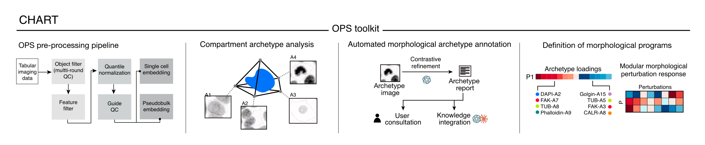

# CHART

**CHART** (**Cellular High-content imaging Archetype Response Toolkit**) translates high-content imaging features into interpretable morphological phenotypes. CHART identifies marker-specific cellular archetypes, annotates representative images using multimodal large language models, and integrates co-regulated archetypes into morphological programs that describe coordinated cellular responses to perturbation. The method and its application are described in [Coelho, Leote et al. (2026)](https://doi.org/10.64898/2026.10.07.757470), *bioRxiv*.



## Components

- **OPS preprocessing** — quality control, filtering, normalization, outlier detection, guide filtering and single-cell/aggregated embeddings.
- **Compartment archetype analysis** — identification of distinctive reference morphological states for each imaged marker.
- **Automated archetype annotation** — contrastive image analysis and standardized reports generated with multimodal language models and user review.
- **Morphological program definition** — integration of co-regulated archetypes into interpretable programs of coordinated cellular change.

## Documentation

The [documentation](https://genentech.github.io/CHART/) describes the input data, each stage's usage, outputs and method, the configuration, and running on a cluster.

## Installation

`environment.yml` describes a conda environment with CHART, SCALLOPS, and the R packages the archetype analysis needs. From the repository root:

```
mamba env create -f environment.yml
conda activate chart
Rscript -e 'install.packages("archetypes", repos="https://cloud.r-project.org")'
```

The optional annotation stage needs `pip install ".[annotation]"` and credentials for a language model in the environment. [Installation](https://genentech.github.io/CHART/installation.html) covers these, SCALLOPS for reading images, and remote storage.

## Quickstart

Write a config saying where the input is and where output should go:

```yaml
data_output_dir: /work/screen1/bulk
local_output_dir: /work/screen1/reports

preprocessing_bywell:
  merged_dir: /data/screen1/objects        # where the input parquet lives

archetypes:
  channels: [TOM20]                        # the channels to analyse
  all_channels: [DAPI1, TOM20, Golgin97]   # every channel the table holds
```

Then run the five stages in order:

```
chart preprocessing --config my_screen.yaml --all-wells
chart archetypes --config my_screen.yaml --all-channels
chart annotation --config my_screen.yaml --all-channels   # optional
chart effects --config my_screen.yaml --all-channels
chart programs --config my_screen.yaml
```

Before `chart effects`, inspect each archetype's crops under `archetypes/<channel>/crops/` in `local_output_dir`, and list those reflecting segmentation errors or staining artefacts under `archetypes.archetypes_to_remove`, as described in [Curating archetypes](https://genentech.github.io/CHART/archetypes.html#curating-archetypes). `example_config.yaml` lists every setting, and [Configuration](https://genentech.github.io/CHART/configuration.html) explains which matter most.

## Citation

If you use CHART in your work, please cite:

> **Archetype analysis of multiplexed antibody imaging reveals interpretable morphological programs in optical pooled screens**
>
> P. P. Coelho, A. C. Leote, H. Yao, P. Wu, T. Kudo, H. Wang, V. Ermakov, A. Saboowala, T. Makino, R. Littman, R. Lopez, J. Kim, T. Hafner, O. Rozenblatt-Rosen, D. Richmond, L. Garraway, A. Singh, J. Marioni, A. Regev
>
> _bioRxiv_ 2026. doi: [10.64898/2026.10.07.757470](https://doi.org/10.64898/2026.10.07.757470)
